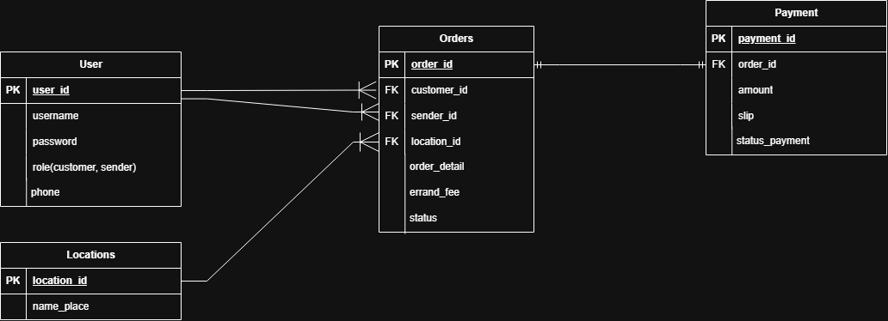

ระบบรับหิ้วในบางแสนและบริเวณมหาวิทยาลัยบูรพา

Pain Point
- นิสิตต้องการสั่งอาหารหรือซื้อสินค้าจากร้านค้ารายย่อยรอบมหาวิทยาลัย (เช่น ร้านหน้ามอ, ซอยสดใส) หรือร้านค้าใดๆ ที่ไม่ได้เข้าร่วมแอปพลิเคชั่นเดลิเวอรี
- ค่าจัดส่งผ่านแอปพลิเคชันเดลิเวอรีทั่วไปมีราคาสูงเกินไป ไม่ตอบโจทย์นิสิต
- ผู้ใช้งานไม่มีเวลาหรือไม่สะดวกเดินทางไปซื้อของด้วยตัวเอง

กลุ่มเป้าหมาย
- Customer (ผู้ฝากซื้อ):นิสิตหรือบุคลากรในมหาวิทยาลัยบูรพาที่ต้องการสั่งซื้อสินค้าและอาหาร
- Sender (ผู้รับหิ้ว): นิสิตที่ต้องการหารายได้พิเศษจากการรับจ้างหิ้วของในพื้นที่ใกล้เคียง

Solution (การแก้ปัญหา)

-พัฒนา Web Application ที่เป็นแพลตฟอร์มส่วนกลางสำหรับจับคู่ 'ผู้ฝากซื้อ' และ 'ผู้รับหิ้ว' ในพื้นที่บางแสนและมหาวิทยาลัยบูรพา โดยผู้ฝากซื้อสามารถโพสต์ออเดอร์ระบุพิกัดร้านและจุดส่งของได้ และผู้รับหิ้วสามารถเข้ามากดรับงานได้โดยตรง เพื่อให้เกิดการให้บริการที่รวดเร็วและมีค่าจัดส่งที่เป็นมิตร

ขอบเขตฟีเจอร์หลัก (CRUD & Auth)
- Auth: ระบบสมัครสมาชิกและ Login / Logout สำหรับตรวจสอบสิทธิ์การใช้งาน
- Create (C): ลูกค้าสามารถโพสต์สร้างออเดอร์ใหม่ได้ (ระบุร้าน, รายการสินค้า, จุดรับ-ส่ง, ค่าหิ้ว)
- Read (R): แสดงหน้ารวมออเดอร์ทั้งหมดที่ยังไม่มีผู้รับงาน เพื่อให้ Sender สามารถเลือกดูและพิจารณารับงาน
- Update (U): Sender สามารถอัปเดตสถานะออเดอร์ได้ (เช่น รับงานแล้ว, กำลังไปส่ง, จัดส่งสำเร็จ) และระบบรองรับการอัปเดตสถานะการชำระเงิน
- Delete (D): ลูกค้าสามารถกดยกเลิกออเดอร์ของตัวเองได้ (เฉพาะในกรณีที่ยังไม่มี Sender กดรับงาน)

Draft ER Diagram

